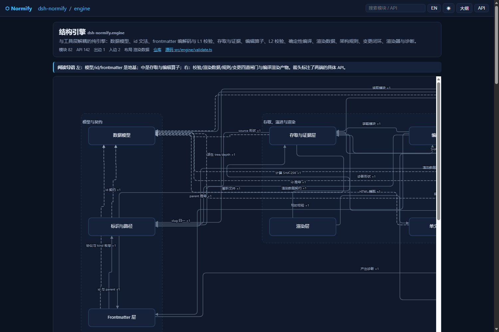
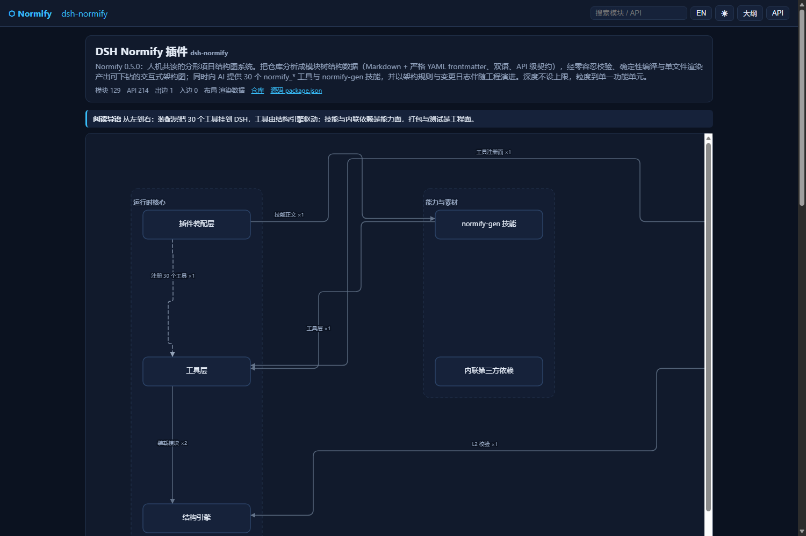
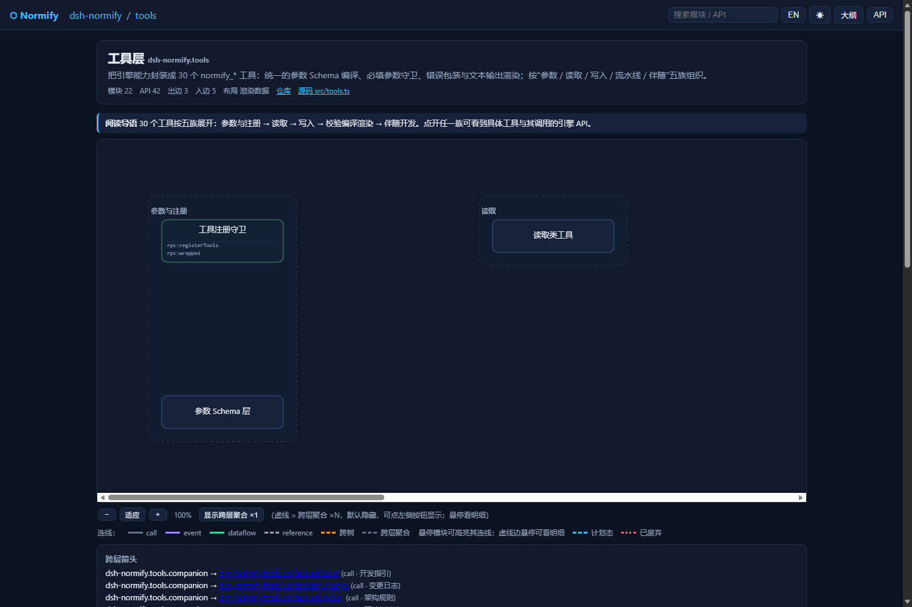
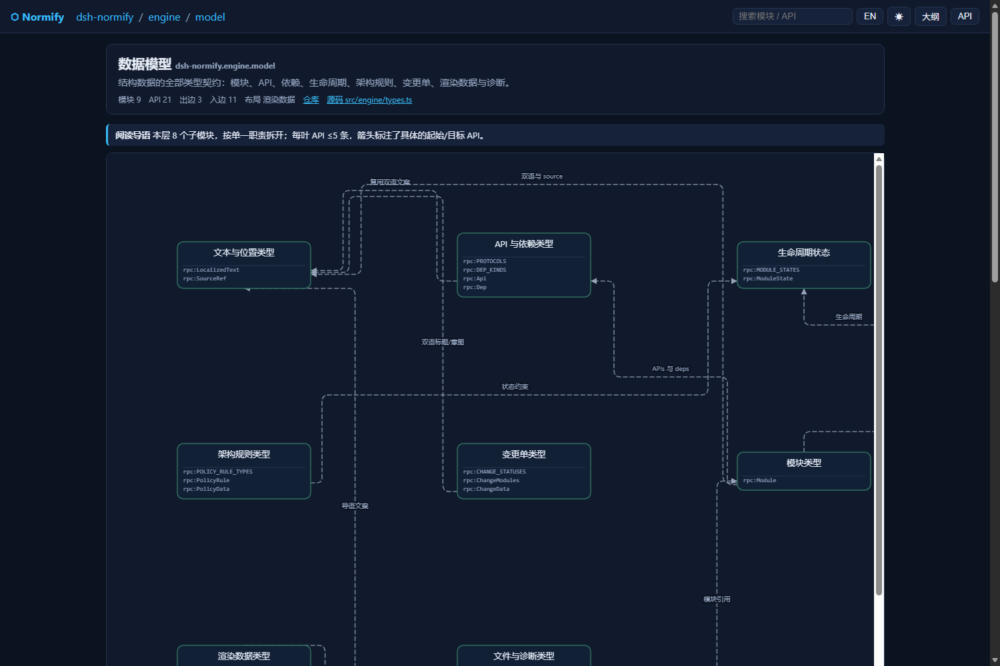

<p align="center">
  <a href="./README_EN.md">English</a> · <strong>简体中文</strong>
</p>

<p align="center">
  
  
  
  
  
  
</p>

<h1 align="center">Normify · 归一化框架图构建器</h1>

<p align="center"><b>把整个项目描述成一棵"人机共读"的分形模块树：AI 负责分析与创作，确定性引擎负责校验、编译与渲染 —— 点开任意模块，就是一张更精细的子图。</b></p>

---

## 0. 一句话

Normify 是 **DeepSeek Harness（DSH）插件**，也是**一套写给 AI 用的开发流程**：

- **给 AI 的**：`normify-gen` 技能 + **7 个原语工具**（`normify_project` / `read` / `write` / `check` / `build` /
  `render` / `change`，按 `op` 分派；旧 31 个工具名可经 `legacyTools` 过渡）—— 让模型把仓库分析成模块树结构数据，
  并在后续开发中**先建图后编程、伴随编程改图**（计划态建树 → 逐个实现 → 关单收尾）。
- **给引擎的**：零容忍校验（L1 写时 / L2 全项目 / L3 冻结）+ 确定性编译（`tree.json` 等五件产物 + `receipt.sha256` 回执自证链）
  + 渲染数据（`renders/`，决定"每一层怎么画"）。
- **给人的**：**单文件交互式架构图**（`normify.html`）—— 逐层下钻、悬停看介绍、一键中英切换、深链接、
  多树、**API 直连箭头**、跨层聚合、缩放与搜索。零依赖，双击即开。

> 它不是"生成一张图就结束"的工具：结构数据与代码**互为契约**，每次改动都能被 `normify_check{op:"drift"}` 检出漂移，
> 并以 `normify_change{op:"close"}`（**0 error 强制**）收尾，让"代码 → 架构图"永远同步。

<p align="center">
  
  <br><sub><b>引擎层</b>：14 个模块、API 直连箭头（箭头锚定到具体 API 行）、带标签的子系统依赖、跨层聚合虚线</sub>
</p>

## 1. 它解决什么问题

| 痛点 | Normify 的做法 |
| --- | --- |
| 架构图一画完就过期 | 结构数据是**可校验的源数据**：`normify_check{op:"drift"}` 按 `fingerprint` 检出漂移，`normify_change{op:"close"}` 强制 0 error 收尾 |
| 图太粗，看不出接口契约 | 粒度到**单一功能单元**，API 写在叶子上，箭头可锚定到具体 API（`from_api`/`to_api`） |
| AI 改代码时"看不见全局" | `normify_read{op:"brief"}` 给出目标模块契约、影响面（谁依赖我）、规则约束与验收清单 |
| 设计先写代码后补文档，必然漂移 | **计划态先建树**（`state: planned`）→ 实现后 `normify_change{op:"close"}` 自动刷新指纹并激活 planned（legacy 可手动 `normify_module_refresh(activate)`） |
| 结构规范靠人自觉 | `policy.yml` 架构规则（依赖方向 / 禁依赖 / 无环 / 深度 / 跨树 / 命名）由 `validate` 强制执行 |
| 大仓库一次生成太重 | 增量再生成：只重建受影响子树，`layouts_to_review` 点名要复核的层 |

## 2. 核心特性

### 2.1 数据模型：分形 + 零冗余

- **唯一元素**：整个数据库由无数个结构完全相同的**基本模块**构成（每个模块 = 一个 Markdown 文件）。
- **只存 `parent`**：单方向引用，`children` 由索引导出 —— 不会出现"父子各说各话"。
- **API 只在叶子存一次**：聚合、统计、索引全部是编译期派生数据（`tree.json` / `api-index.json`）。
- **两类边**：containment（树边，导航骨架）+ dependency（箭头，可跨子树、跨树，按 `kind` 着色）。
- **路径式 id + 不变 uid**：AI 沿 id 逐层定位（类二分查找）；`uid` 在改名/移动时保持不变，git diff 稳定。
- **深度不设上限**（0.5.0 起）：想有多细就拆多细，深度不再成为"合并模块"的理由。

### 2.2 三层校验，fail-closed

| 层 | 时机 | 内容 |
| --- | --- | --- |
| **L1** | 每次写入 | 必填字段、id 文法、uid、parent 一致性、双语长度、source/apis/deps 形状、state/replacement |
| **L2** | `normify_check{op:"validate"}` | 全项目：唯一性、文件↔id 映射、叶子/非叶子规则、API 键唯一、依赖目标、环、渲染数据交叉校验、架构规则、变更日志、（可选）仓库证据（source 存在性 + 指纹一致） |
| **L3** | `normify_build{op:"build"}` | 任何 error 都不产出产物；产出 5 件产物（tree/outline/api-index/structure-manifest/receipt）+ `receipt.sha256` 回执链 |

每条诊断都带 `severity / code / message / subject / evidence / supportedFixes` —— **AI 可自行修复**。

### 2.3 渲染器：单文件、可下钻、API 直连

- 单文件 HTML（内联 CSS/JS，**零外部依赖**、零遥测），双击即开，可直接归档/发人。
- 逐层下钻 + 面包屑 + 搜索（模块名/API）+ 大纲视图 + API 浏览器。
- **API 直连**：叶子框内展示 API 明细行，箭头锚定到具体 API 行的端口；同一 API 行上的多条边自动扇形分离。
- 跨层依赖聚合为虚线 `×N`（默认隐藏，工具栏或 `?agg=1` 开启，悬停看明细）。
- 深链接：`#module=<id>`、`#api=<rpc:key>`、`#view=outline`、`?lang=zh|en`、`?agg=1`；缩放 / 悬停高亮 / 明暗主题。
- **几何自检**：渲染器内置逐层几何断言思路（线不出界 / 不贴框 / 不穿框 / 不压线）；早期用于校验截图的独立脚本未随仓库分发。

### 2.4 伴随开发：先建图后编程

```
normify_change{op:"open"} → normify_read{op:"brief"} → normify_check{op:"check"}
  → normify_write{op:"batch"}(state=planned) → 【写代码】→ normify_change{op:"close"}(0 error 强制) → verified + revision.after
```

- **计划态**：源码还不存在也能先建树（`fingerprint: pending`），`normify_check{op:"validate"}` 放行；
- **禁止假激活**：源码没落地就 `activate` / `close` 直接被拒；
- **收尾即闭环**：`change{op:"close"}` 会刷新指纹 → 校验（0 error 强制）→ 编译（可选渲染）→ 标记 `verified`，
  任何一步失败都不关闭，变更保持原状态；
- **改图随代码**：`normify_check{op:"drift"}` 用 `git diff` + 未跟踪文件定位受影响模块与指纹漂移，`write{op:"patch"}` 跟随更新。

### 2.5 架构规则先行（policy.yml）

| 规则 | 作用 |
| --- | --- |
| `dependency-direction` | 层顺序即允许的依赖方向（如 plugin → tools → engine），可控制同层是否允许 |
| `forbid-dependency` | 禁止某些 from → to 的依赖（可按 kind / state 过滤） |
| `acyclic` | 依赖图禁止成环（可含跨树） |
| `max-depth` | id 段数上限（**可选**：不写就是不限，0.5.0 起默认不限） |
| `cross-tree` | 跨树依赖策略：`forbid` / `allow` / `require-to-api` |
| `naming` | 作用域内 id 段的命名正则 |

安装后 `normify_check`（op=validate/check/drift）与 `normify_build`（op=build）全部强制执行；**违规先改设计，不能绕过**。

## 3. 最新变化

### v0.7.0 · 默认工具面切换为 7 原语（当前版本）

- **默认 7 原语**：`normify_project / read / write / check / build / render / change`（按 `op` 分派，见 §7）；
  常驻 schema 体积与工具选择歧义显著下降。
- **平滑过渡**：`config.legacyTools: true` 在 7 原语外额外注册 31 旧名（过渡 1 个 minor）；`config.toolset: "full"` 完全回旧面。
- **不变**：结构数据格式 v1、五件产物 + SBOM + `verify` 回执链、CLI 命令与退出码、安装方式与 DSH 兼容范围。
- **评测**：新增检索层评测（n≥3、可复跑，见 [docs/EVAL-RESULTS.md](docs/EVAL-RESULTS.md)）；旧 A/B 表述改为
  "n=1 可行性实验"（方法学见 [docs/EVAL.md](docs/EVAL.md)）。
- **分发与决策门**：新增 [docs/MARKET.md](docs/MARKET.md)（官方市场/dshbase/dshhub 材料）；ADR-0011（0.7 不做 Harness 内 UI 面板）、
  ADR-0012（0.7 不做 MCP 适配，CLI-first）。
- 验收：`pack-smoke --all --strict` **PASS 43 / FAIL 0 / WARN 0**；platform-contract 25/25（7 原语 / legacy / full 三模式）。

### v0.6.0 · Phase 1 内部重构（core/dsh/cli + CLI + SBOM）

- `src/core`（纯 Node 引擎）/ `src/dsh`（DSH 适配层）/ `src/cli`（跨 agent CLI）；`lib/` 不再入库。
- 新增 CLI、结构 SBOM（`structure-manifest.json`）、`receipt.sha256` 自证链、`normify verify`、语义化结构 diff。
- DSH 适配层：真实 `output.schema` / presenters / destroy 审批；测试与 CI 矩阵；写路径性能大幅提升。
- **公开面不变**：31 工具名、数据格式 v1、安装契约不变（7 原语为 opt-in）。

### v0.5.5 · P0 止血：兼容当前 DSH 0.2.x

- **兼容当前最新 DSH**：`engines.dsh` 改为 `>=0.2.1-rc.1 <0.3.0`（目标运行时 DSH `0.2.1-rc.5`）；
  只支持当前 DSH 线，0.1.x 环境请留在 0.5.4。
- **安全修复**：`normify_sync` 的 `diff` 范围拒绝以 `-` 开头的选项注入；`normify_render` 的 `out` 只接受纯文件名
  （越界报 `render/invalid-out`）；`normify_fingerprint` 的 `source` 只接受仓库内 POSIX 相对路径，越界/符号链接按缺失处理。
- **L3 回执可自证**：`receipt.json` 不再把自身写入 `artifacts`，新增同目录 `receipt.sha256` sidecar，五件产物可逐件复算。
- **数据正确性**：`id` 末段保留段名 `index` 写入前拒绝（`structure/id-reserved`）、空 batch / 孤儿 upsert /
  坏文件读取显式报错（`args/empty-batch` / `structure/parent-not-exist`）、环检测回归 L2
  （`structure/dependency-cycle`）、delete 型变更单不再死锁（`change_close` 可用）。
- **渲染安全**：HTML `<title>` 转义与 `/s+/g` 修正；写盘统一原子写。
- **文档**：安装段改为 DSH 0.2.x 插件管理器/插件市场；兼容表、工具数（31）、源码规模（17 个 `.ts` / 约 7.6k 行）、
  测试套数（5 套）口径统一。

### v0.5.4 · 把"第二轮 A/B 实测"暴露的 4 个工具缺陷修掉

第二轮 A/B 换了题目（**表格公式引擎 + CLI**，同一份规范、隐藏黑盒 88 项、外加**差分模糊测试**）。
两组最终 B 88/88、A 87/88（差异只有一条 §5.2 语义）；这一版修的是**工具侧**新暴露的 4 个坑：

- **`mode:"patch"` 的静默 no-op 被拦下**：原来 `items:[{patch:{id, tags:[...]}}]`（少一层包装）会返回
  `ok:true, count:1` 却**一个字段都没改**——最危险的"假成功"。现在直接报 `args/invalid-patch`，
  evidence 里给出收到的键与正确形状 `{patch:{id, patch:{...}}}`；单模块 `normify_module_patch` 传空补丁
  同样报 `args/empty-patch`（只给 `expect_updated_at` 也不再静默通过）。
- **`normify_module_refresh` 不再强依赖 git**：`repoRoot` 不是 git 仓库时，以前直接失败
  （实测中 AI 只能 `git init` 才能激活模块）；现改为降级并给 `refresh/git-unavailable` 警告。
- **`change_open` 的 `acceptance` 报错具体化**：以前把 `{zh,en}` 写进 acceptance 只有一句笼统报错；
  现在明确写出"**第 N 条不是非空字符串（收到 …）：验收标准只接受纯字符串**"，并提示双语描述写进 `title`/`intent`。
- **`normify_help` 支持 `topic:"tool:<工具名>"`**：`tools` 主题现在每个工具都带**必填/可选**摘要，
  新主题可按需打印**完整参数树**（类型 / 描述 / 必填，由注册表实时生成、与运行时校验同源）。
  实测里 AI 为确认 `mode=patch` 的嵌套形状去读了插件源码——这条主题正是为了消灭这种绕路。

### v0.5.3 · 把「伴随编程实测」暴露的 4 个摩擦点修掉

这四个问题来自一次真实的 A/B 对照实验：两个 AI 用同一份规范写同一个后端，一个带插件走伴随流程、一个纯手写
（最终代码在隐藏黑盒验收上都是 **42/42**）。插件组多交付了 41 模块 / 110 API / 10 层的结构数据，但也踩到了下面 4 个坑：

- **`normify_help` 支持 `topic`**：此前它完全忽略入参，只返回同一份字段速查 —— 实测里 AI 为了拿准
  `change_open` / `layout_upsert` / `change_close` 的参数名，只能去读插件源码（多花约 4 分钟）。
  现在按主题返回：`fields`（默认）/ `deps`（箭头与 API 直连）/ `renders` / `flow`（伴随流程）/ `tools`（工具清单）/
  `policy` / `errors`（常见诊断码与修法）/ `all`；**传错主题会直接报错并列出可用主题**，不再静默忽略。
- **项目初始化通道**：新增第 31 个工具 `normify_project_init` —— 建 `normify-<slug>/` + 默认架构规则，
  可选 `root` 一步创建"计划态根模块"（幂等）；同时 `normify_change_open` 现在也会**自动建项目目录**
  （此前报“项目目录不存在”错误，AI 只能用 `module_batch {items:[],dry_run:true}` 绕过去）；
  `normify_brief` 遇到不存在的模块会给出"先 init / 先建树 / 改用 task"的可执行提示。
- **批量诊断的因果链**：一条 `label-too-long` 曾连带出 3 条 `dep/target-missing`（因为 L1 失败的模块会被移出批次工作集），
  AI 只能去读源码才能确认根因。现在连带错误改报 `dep/target-dropped` / `structure/parent-dropped`，
  在 message 与 evidence 里点明**根因诊断码**，并在失败响应的 `root_causes` 里直接列出被丢弃的模块（附 `hint`）。
- **「API 直连」引导**：两端都声明了 API 却没写 `from_api` / `to_api` 的箭头，`normify_validate` 会给出**聚合**
  warning `dep/unanchored`（条数 + 前 3 条示例）。这正是实验里被浪费的能力：110 条 API 声明，54 条箭头 0 条锚定 ——
  不锚定，箭头就只能落在框边，钉不到 API 行上。**引导≠放宽**：锚错键仍然是 error。

### v0.5.2 · 修掉三处会写坏数据的真实缺陷

- **`normify_module_upsert` 的必填表不再丢失**：`parameters.required` 恢复为 `["frontmatter"]`，
  `frontmatter` 的 9 个必填字段（uid / id / parent / name / description / source / revision / updated_at / fingerprint）
  也重新出现在 schema 里。此前嵌套 schema 被二次编译，必填表被整段丢掉 —— 模型看到的约束与运行时实际校验不一致。
- **`normify_module_move` 迁移渲染数据时重写内容**：`id` / `order` / `groups.children` / `edge_hints` 全部改写到新 id，
  并同步维护**旧父级**（删掉已迁出子模块的引用）与**新父级**（把新 id 补进 `order`）。
  修复前：move 完之后项目立刻被 L2 判为 `layout/id-mismatch` + `layout/order-child` 等（实测 8–9 个 error，0.5.2 后为 0）。
- **晋升为容器时不再把 API 留在容器上**：叶子被晋升（显式 `normify_module_promote`、写子模块自动晋升、move 到叶子底下）
  时，容器上残留的 `apis` 会被摘除，并回报 `structure/api-dropped-on-promote` 警告（附丢失的 API 键清单）——
  修复前项目会直接卡在 `api/non-leaf`。
- **API 默认全展开**：渲染数据字段 `max_api_rows` 缺省 **0 = 全部展开**，叶子上的 API 一行不折叠；需要收窄时显式写 1..48。
- 三处缺陷各自配了回归断言：`tests/regression-0.5.2.mjs`（34 项，全绿）。

### v0.5.1 · 渲染器防重叠（线压线 12 → 0）

- **修复连线共线重叠**：28 层合计 **12 处 → 0 处**。四处根因：
  ① 首选路由只判"不穿别人的框"，从不检查是否压到已画的线 → 改为只接受 `violations === 0` 的候选；
  ② API 锚定端口没有端口分离（同一 API 行被多条边共用） → 行内 ±5.5px 扇形分离；
  ③ API 端口落在上下边时被放进框内部 → 上下边退回按边均匀分离；
  ④ `segClear` 整块跳过源/目标框 → 新增"进入自身框内部"检查（内缩 2px）。
- 节点/分组间距 170 → 220，给密集层更多自由通道。

### v0.5.0 · 取消模块数量上限

- **删除 `MAX_DEPTH = 12`** 硬限制：树可以一直下钻到"单一功能单元"；需要限层时用 `policy.yml` 的
  `max-depth` 规则显式声明（`maxDepth` 放宽到 1..64）。
- SKILL：目标深度改为"不设上限"，单批上限 40 → 200，新增"每叶 API 尽量 3–5 条"的粒度指引。
<details>
<summary>更早的版本（v0.4.x / v0.3 / v0.2 / v0.1）</summary>

- **v0.4.1**：渲染器 v3 定稿（自由通道走线、viewBox 全几何自适应、API 直连、跨层聚合、缩放与悬停）；
  `normify_sync` 识别**未跟踪的新文件**（`git ls-files --others`）。
- **v0.4.0**：伴随开发（`state: planned`/`deprecated`、`replacement`、`tags`）、架构规则 `policy.yml`、
  变更日志 `changes/` 与 `normify_change_close`（0 error 强制）、编辑算子 `module_patch/batch/move/refresh`、
  `normify_brief` / `normify_check`、`sync v2`、提醒钩子；工具 15 → 30。
- **v0.3.0**：渲染数据集 `renders/`（`order`/`groups`/`mode`/`reading`/`edge_hints`）、id 段上限 8 → 12、下钻粒度放开。
- **v0.2.0**：适配 DSH 0.1.5-rc.2；工具名 `normify.x.y` → `normify_x_y`；bundle 层 `cordis.patch.yml`；
  工具 `parameters` 编译为标准 JSON Schema；只读工具标记 `isConcurrencySafe`。
- **v0.1.0**：初始版本（14 个工具、数据模型 v1、渲染器 v1）。

</details>

## 4. 截图

| 总览层（129 模块） | 工具层（0.6 视图：31 工具；0.7 起默认 7 原语） |
| --- | --- |
|  |  |

| 引擎层（API 直连箭头） | 模型层（修复后的干净走线） |
| --- | --- |
|  |  |

> 上面几张都是 **Normify 对自身源码**生成的架构图（129 模块 / 214 API / 257 箭头 / 28 层渲染数据，`validate` 0 error）。

## 5. 安装

Normify 以 **DSH bundle** 形式分发，只支持 **DSH 0.2.x**（`engines.dsh: ">=0.2.1-rc.1 <0.3.0"`）。
安装后请**新开一个 DSH 会话**：工具列表在会话启动时快照。

### 方式 A：插件管理器 / 插件市场（推荐）

在 DSH 会话里让 AI 通过插件管理器安装（`plugin_manager` 的 `install_bundle`），目标可以是：

- **本仓库目录**（从源码安装时先 `npm install && npm run build`；`lib/` 已不再入 git，需先构建）；
- **本地发行包**（`npm pack` 生成的 `dsh-external-dsh-normify-<version>.tgz`，或对应 Release 附件），安装 spec 以插件管理器提示为准；
- **插件市场条目**（若你配置的市场索引已收录本插件，可直接在插件市场页面安装）。

安装由 DSH 插件管理器完成：校验 `engines` → 写入 profile → 登记 bundle。
**不需要手工编辑 profile 的 `package.json`、`node_modules` 或 `cordis.patch.yml`** ——
插件行由 bundle 自身声明（`package.json > dsh.bundle.patch: ./cordis.patch.yml`）。

### 方式 B：`dsh plugin` CLI

```bash
# <profile> 为当前 DSH profile 名（可在 ~/.dsh/profiles/ 下查看）
dsh plugin --profile <profile> add <dsh-normify 包目录或 .tgz 的绝对路径>
```

CLI 参数以当前 DSH 版本自带的 `dsh plugin --help` 为准；不同 DSH build 的语法可能略有差异。

### 验证安装

```text
在 DSH 新会话里直接问 AI：列出你手上的 normify 工具
# 默认应看到 7 个原语；legacyTools:true 时额外有 31 个旧名；toolset:"full" 时为 31 个旧工具
```

> ⚠️ 版本不兼容时插件管理器会报 `incompatible-version` 并回滚：请使用 **0.7.0+**（支持 DSH 0.2.x）；
> 仍需运行在 0.1.x 的旧环境请保留 0.5.4。

## 6. 快速开始

装好后，直接用自然语言指挥 AI 即可。最常用的三条：

```text
# ① 为仓库建架构图（首次全量生成 + 渲染）
用 normify-gen 技能为 F:\my-project 建结构树并渲染架构图，粒度到单一功能单元。

# ② 先建图后编程（推荐开发姿势）
我要给 my-project 加一个「限流」模块：先给我 brief 指引（normify_read op=brief），建计划态模块，我实现完再 change_close 收尾（它会自动刷新并激活 planned）。

# ③ 代码改了，同步结构图
同步 my-project 的结构图（normify_check op=drift），把受影响的模块与渲染数据更新掉，0 error 后重新 build + render。
```

AI 侧实际会跑（0.7 默认 7 原语；括号内为 op）：

```text
normify_project{op:"init"} → normify_write{op:"batch"}（根 + 一级子模块，原子）
  → normify_read{op:"list"}（逐层下钻）
  → normify_write{op:"layout_upsert"}（每个容器一层渲染数据）
  → normify_check{op:"validate"}（0 error 门禁）
  → normify_build{op:"build"} → normify_render{op:"render"}
  → normify_build{op:"verify"}（或 CLI `verify`）确认回执链
```

产物（默认写在结构数据目录 `normify-<slug>/` 下）：

| 产物 | 内容 |
| --- | --- |
| `modules/**/*.md` | 结构数据本体（frontmatter + 正文） |
| `renders/**/*.json` | 每个容器一层的渲染数据 |
| `policy.yml` | 架构规则（项目创建时自动安装默认规则） |
| `changes/<id>.json` | 开发变更日志（随结构目录一起回档） |
| `tree.json` | 编译产物：模块字典 + API 索引 + 边 + 渲染数据 + 规则 + 变更统计 |
| `outline.md` / `api-index.json` | 人类可读大纲 / API 索引 |
| `structure-manifest.json` | 结构 SBOM：模块/API/依赖确定性清单 + 产物哈希（0.6.0 起） |
| `receipt.json` | 各产物 SHA-256 冻结回执（不含自身） |
| `receipt.sha256` | `receipt.json` 自身的校验和（sidecar，供外部复算） |
| `normify.html` | 单文件交互式架构图 |

## 7. 工具面：7 原语（legacyTools 过渡）

0.7.0 起 DSH 默认只注册 **7 个原语**（按 `op` 分派）。CLI 内部仍用 full 工具集（命令不变）。

| 原语 | op | 用途 |
| --- | --- | --- |
| `normify_project` | `init` / `list` / `status` | 初始化项目（可一步建计划态根模块）/ 列出全部项目 / 项目概览 |
| `normify_read` | `get` / `list` / `search` / `deps` / `outline` / `brief` / `layout` / `policy` | 只读查询：模块 / 列模块 / 检索 / 反查依赖 / 大纲 / 开发指引 / 渲染数据 / 架构规则 |
| `normify_write` | `upsert` / `patch` / `batch` / `move` / `delete` / `promote` / `layout_upsert` / `layout_delete` | 事务化写入（L1 校验、原子批、`dry_run`） |
| `normify_check` | `validate` / `check` / `drift` / `policy` | L2 校验 / 设计预检 / git 漂移与增量规划 / 读规则 |
| `normify_build` | `build` / `verify` / `sbom` | 编译五件产物 + SBOM + 回执链 / 只校验不重编译 |
| `normify_render` | `render` | 渲染单文件交互式 HTML（`out` 只接受纯文件名） |
| `normify_change` | `open` / `update` / `list` / `close` | 变更生命周期；`close` **0 error 强制**并激活 planned |

**工具面配置**（插件 config）：

| 配置 | 默认 | 效果 |
| --- | --- | --- |
| `toolset: "core"` | ✅ | 只注册 7 原语 |
| `toolset: "full"` | — | 只注册 31 旧工具（完全回 0.6 面） |
| `legacyTools: true` | `false` | 在 7 原语外**额外**注册 31 旧名（过渡 1 个 minor，0.8 移除） |

- `legacyTools:true` 的注册项 = 7 + 28 = 35；其中 `normify_check` / `normify_build` / `normify_render` 三个名字与旧名同名，
  过渡期请直接用原语 `op`。
- CLI（`normify ...` / `call <tool>`）不受插件 `toolset` 影响，始终可用 full 31 工具。

**31 旧名 → 原语 op 映射（迁移用）**

| 旧工具名（0.6） | 0.7 用法 |
| --- | --- |
| `normify_project_init` / `normify_tree_list` | `normify_project{op:"init" / "list"}` |
| `normify_module_get` / `_list` / `_search` / `_deps_find` / `_outline` / `_brief` | `normify_read{op:"get"/"list"/"search"/"deps"/"outline"/"brief"}` |
| `normify_layout_get` / `normify_policy_get` | `normify_read{op:"layout"/"policy"}` |
| `normify_module_upsert` / `_patch` / `_batch` / `_move` / `_delete` / `_promote` | `normify_write{op:"upsert"/"patch"/"batch"/"move"/"delete"/"promote"}` |
| `normify_layout_upsert` / `normify_layout_delete` | `normify_write{op:"layout_upsert"/"layout_delete"}` |
| `normify_validate` / `normify_check` / `normify_sync` | `normify_check{op:"validate"/"check"/"drift"}` |
| `normify_build` / `normify_render` | `normify_build{op:"build"/"verify"/"sbom"}` / `normify_render{op:"render"}` |
| `normify_change_open` / `_update` / `_list` / `_close` | `normify_change{op:"open"/"update"/"list"/"close"}` |
| `normify_fingerprint` / `normify_module_refresh` / `normify_help` / `normify_policy_upsert` | **无原语等价**：需要时开 `legacyTools:true` 或走 CLI（`normify call ...`） |

> 每个原语的参数树可用 `normify_help{topic:"tool:<name>"}`（legacy 模式）或 `node lib/cli/index.js call <tool> --args-json ...` 查看。

## 8. 数据结构（模块 frontmatter）

```yaml
---
uid: 8c69b5a8                 # 8 位小写 hex，全项目唯一，改名/移动都不变
id: dsh-normify.engine.ids    # 路径式 id，首段=树名；深度不设上限
parent: dsh-normify.engine    # 必须等于 id 去尾段；根为 null
name: {zh: "标识与路径", en: "Identifiers & Paths"}
description:                  # 双语，各 ≤500 字符，人机共读
  zh: >
      模块 id 的文法、派生与 id ↔ 文件路径的双向映射。
  en: >
      Module id grammar, derivations and the id ↔ file-path mapping.
source:                       # 代码证据（仓库相对路径 + 可选行号）
  - {path: src/engine/ids.ts, line: 6, end_line: 34}
revision: 90df4a10…           # 生成时仓库的 40 位 git SHA
updated_at: "2026-09-12T12:00:00Z"
fingerprint: 630ac9020dba…    # source 的确定性指纹（用 normify_fingerprint 计算）
state: active                 # active | planned（计划态）| deprecated（废弃）
tags: [engine, ids]           # 可选，≤12 个
apis:                         # 仅叶子；每叶建议 3–5 条
  - protocol: rpc             # http|ws|rpc|amqp|kafka|mysql|redis|file|grpc|graphql
    path: splitId
    description: {zh: "解析 id 为段数组。", en: "Parses an id into segments."}
deps:                         # 出向箭头（只存源端）；可跨树
  - kind: call                # call|event|dataflow|reference
    to: dsh-normify.engine.model.module
    from_api: rpc:splitId     # 可选：锚定到本模块的某个 API（"API 直连"）
    to_api: rpc:Module
    label: {zh: "id 契约", en: "Id contract"}
---
（正文：给人类读者的展开介绍，可选）
```

文件布局：`modules/<树名>/<路径段…>/index.md`（容器）/ `<最后一段>.md`（叶子）—— 由工具自动维护形态。

## 9. 渲染数据（`renders/`，决定"这一层怎么画"）

每个**容器模块**一层，与模块一一对应：

```json
{
  "schema_version": 1,
  "id": "dsh-normify.engine.model",
  "updated_at": "2026-09-12T12:00:00Z",
  "mode": "grid",              // auto | layers | groups | grid
  "max_columns": 3,            // 1..6
  "max_api_rows": 0,           // 0 = 全部展开（缺省）；1..48 = 截断到该行数
  "reading": {"zh": "本层 8 个子模块…", "en": "…"},
  "order": ["dsh-normify.engine.model.text", "…"],
  "groups": [{"id": "model", "title": {"zh": "模型与契约", "en": "Model"}, "children": ["…"]}],
  "edge_hints": [{"from": "a", "to": "b", "lane": 2, "style": "curve"}]
}
```

可读性配方：**顺序 = 数据流**、**分组 = 领域边界**、**导语 = 阅读路径**、长回边用 `edge_hints` 拉开车道。

## 10. 架构规则（`policy.yml`）

```yaml
rules:
  - id: core-acyclic                 # 依赖图禁止成环
    type: acyclic
    severity: error
    includeCrossTree: true
  - id: layer-direction              # 层顺序 = 允许的依赖方向
    type: dependency-direction
    severity: error
    allowSameLayer: true
    layers:
      - {name: plugin, match: ["dsh-normify.plugin"]}
      - {name: tools,  match: ["dsh-normify.tools", "dsh-normify.tools.**"]}
      - {name: engine, match: ["dsh-normify.engine", "dsh-normify.engine.**"]}
  - id: naming-kebab                 # 命名约束
    type: naming
    pattern: "^[a-z][a-z0-9-]*$"
    scope: ["dsh-normify.**"]
```

项目创建时自动安装默认规则（无环 + 禁指向废弃模块）；读取用 `normify_read{op:"policy"}` / `normify_check{op:"policy"}`，
覆盖用 legacy `normify_policy_upsert` 或 CLI `normify call normify_policy_upsert`。
**深度上限是可选项**：不写 `max-depth` 就是不限层。

## 11. 伴随开发：先建图后编程 / 伴随编程改图

### 11.1 先建图后编程（design-first）

```text
① normify_change{op:"open"}      开变更单（title / intent / modules / acceptance）
② normify_read{op:"brief"}       拿指引：目标模块与契约、影响面（谁依赖我）、规则约束、建议模块、验收清单
③ normify_check{op:"check"}      预检：拟建模块与依赖是否违反核心约束或 policy
④ normify_write{op:"batch"}      建「计划态」模块（state=planned, fingerprint=pending, 源码可以先不存在）
                                  同一轮用 normify_write{op:"layout_upsert"} 写该层渲染数据
⑤ 【人/AI 写代码】               实现对应模块
⑥ normify_change{op:"close"}     自动刷新指纹并激活 planned（legacy 模式可手动 normify_module_refresh）
⑦ 0 error 强制收尾：刷新 → 校验 → 编译 → 标记 verified + revision.after
```

- 计划态下 `normify_check{op:"validate"}` **0 error**（源码未落地也合法，只记 warning）；
- 源码没落地就 `activate` / `close` 会被**拒绝**（禁止"假激活"）；
- 变更单存在结构目录内（`changes/<id>.json`），**随工程一起回档**。

### 11.2 伴随编程改图（companion update）

```text
① 改代码（提交与否都行）
② normify_check{op:"drift"}      检出：changed_files / affected / drift_fingerprints / layouts_to_review
                                  新文件还会给出「建议模块」（含 id 与目标路径）
③ normify_write{op:"patch"}      跟随代码更新模块：补 API、改介绍、标签等
④ normify_check{op:"validate"}   0 error
⑤ normify_change{op:"close"}     收尾并重建产物（tree.json 会反映本次变更统计）
```

> 实测（本项目自身）：改完源码 + `CHANGELOG.md` 后，`drift` 报出多个 `evidence/fingerprint-drift`，
> 刷新后回到 0 error —— 这正是"图与码不脱节"的日常形态。

## 12. 渲染器细节（v3 / 0.5.2）

- **走线**：连线只走"自由通道"（相邻列/行之间的空隙），节点框保持 ≥16px 净空；全局车道坐标注册表保证
  **同一坐标不分配给两条边**；候选路径做框体/组框碰撞检测，兜底用"自由行 × 自由列"总线。
- **防重叠（0.5.1）**：路由首选只接受 `violations === 0` 的候选（不穿框 / 不压已画线 / 不横穿自身框 /
  端口法向正确）；API 锚定端口按到达顺序在 API 行内 ±5.5px 扇形分离。
- **全展开（0.5.2）**：`max_api_rows` 缺省 0 → 每个叶子的 API 全部展开，箭头锚点与 API 行一一对应（不再 `+N` 折叠）。
- **API 直连**：叶子框内展示 `max_api_rows` 行 API（0 = 全部，也是缺省），箭头锚定到具体 API 行的端口。
- **跨层聚合**：跨层依赖默认聚合为虚线 `×N`（`?agg=1` 或工具栏开启，悬停看明细）。
- **viewBox 自适应**：由全部几何包围盒动态计算（线不出视口）；缩放 / 适配 / 100%。
- **几何自检**：渲染器内置逐层几何断言思路（越界 / 贴边 / 穿框 / 贴组框 / 线压线）；早期独立校验脚本未随仓库分发。
  本项目自身 129 模块 / 28 层：**线压线 0 处**，27/28 层五项全 0。

## 13. 工程与测试

```bash
npm install          # devDependencies（typescript / @types/node / cordis / schemastery / cosmokit）
npm run build        # src/ → lib/（tsc；lib/ 不入 git，使用/开发前必须构建）
npm run typecheck    # tsc --noEmit
npm test             # 6 套 e2e/回归：engine / companion / regression-0.5.2 / 0.5.3 / 0.5.4 / 0.5.5
npm run test:unit    # core-unit（引擎单测）
npm run test:contract # platform-contract（7 原语/legacy/full 三模式）+ pack-smoke --contract
npm run test:perf    # 性能冒烟（300 模块，宽松阈值）
node ci-contract-check.cjs           # 契约检查：bundle 声明 + full 31 工具 + provider 安全命名
node scripts/check-core-boundary.mjs # 边界检查：core 禁 @deepseek-ai；cli 禁 ../dsh
node scripts/gen-diagnostics.mjs     # 从源码生成 docs/DIAGNOSTICS.md
node scripts/pack-smoke.mjs --all --strict   # 发布包冒烟（需本机 DSH 桌面端）
```

| 目录 | 内容 |
| --- | --- |
| `src/core/` | 纯 Node 引擎（DSH 无关）：`engine/*`（id/校验/编译/渲染/变更/事务写）+ `toolset.ts`（31 旧工具规格）+ `primitives.ts`（7 原语规格） |
| `src/dsh/` | DSH 适配层：真实 `ToolDefinition`（output schema + presenters + 审批）；决定注册 7 原语 / legacy / full |
| `src/cli/` | CLI（构建后 `lib/cli/index.js`，`bin: normify`），只依赖 core |
| `lib/` | 构建产物（`tsc` 输出；**不入 git**，随发行包发布） |
| `skills/normify-gen/` | 薄技能入口 `SKILL.md`（≤150 行）+ `references/`（格式/校验/配方/迁移/示例/工具面） |
| `tests/` | 6 套 e2e/回归 + core-unit + platform-contract + 性能冒烟 |
| `docs/` | `SPEC.zh-CN.md`（唯一规范真源）+ COMPATIBILITY / MIGRATION / RELEASE-CHECKLIST / DIAGNOSTICS / MARKET / EVAL / adr |
| `vendor/` | 内联第三方（schemastery / cosmokit，按相对路径加载） |

## 14. 兼容性与排错

| 项 | 要求 |
| --- | --- |
| DSH | `0.2.1-rc.5`（engines `>=0.2.1-rc.1 <0.3.0`；peer：`@deepseek-ai/cordis ^4`） |
| 支持策略 | **只支持当前最新 DSH 线（0.2.x）**；0.1.x 环境请留在 0.5.4 |
| 工具面 | 默认 7 原语；`legacyTools:true` → 额外 31 旧名；`toolset:"full"` → 31 旧工具 |
| Node.js | ≥ 18 |

> 完整兼容矩阵与验证证据：[docs/COMPATIBILITY.md](docs/COMPATIBILITY.md)；升级说明：[docs/MIGRATION.md](docs/MIGRATION.md)。

**常见问题**

- **装了但工具不出现** → 工具列表在**会话启动时快照**：请**新开一个会话**（或重启 DSH）。
- **旧工具名报 unknown tool** → 0.7 默认只注册 7 原语：设置 `legacyTools: true`（过渡期）或改用原语 op（映射见 §7）。
- **安装报 `incompatible-version`** → 插件版本与 DSH 运行时的 engines 区间不符：请升级插件到 0.7.0+；旧 DSH 0.1.x 请留在 0.5.4。
- **`evidence/fingerprint-drift`** → 源码变了而结构数据没跟上：`normify_check{op:"drift"}` 看漂移清单，再 `change{op:"close"}` 刷新（legacy 模式用 `normify_module_refresh`）。
- **`structure/leaf-too-coarse`** → 不是错，是提示：该叶子还能继续拆（推荐拆到"单一功能单元"）。

## 15. 安全与隐私

- **无遥测、无网络请求**：结构数据与渲染产物全部在本地生成，`normify.html` 不加载任何外部资源。
- **不做凭据处理**：插件不读取、不写入任何 token / 私钥 / password；`.gitignore` 已排除 `.env*`、`*.pem`、
  `*.credentials.yaml` 等；**仓库内不存在任何凭据，也请不要提交**。
- **只读仓库**：生成器遵守"只读源码"铁律 —— 结构数据只写入 `normify-<slug>/`，绝不修改被分析的仓库。
- `source` 字段只记录**仓库相对路径**与行号，不会把源码内容复制进结构数据。

## 16. CLI（跨 agent / CI）

CLI 与 DSH 工具**同引擎**，不依赖 DSH 运行时：适合终端、CI 与其他 agent。
`lib/` 不入 git，从源码用 CLI 前先 `npm run build`（npm 发行包内已含 `lib/`）。

```bash
node lib/cli/index.js --help        # 命令、选项与退出码
node lib/cli/index.js tools         # JSON：full 工具集 31 个（CLI 不受插件 toolset 影响）
node lib/cli/index.js verify --project demo   # receipt.sha256 → receipt → artifacts 逐件复算

# 常用：结构项目用 --project <slug> 或 --dir <结构目录绝对路径>
node lib/cli/index.js init --project demo --root-id demo
node lib/cli/index.js validate --project demo --repo-root F:/repo
node lib/cli/index.js build --project demo    # tree/outline/api-index/structure-manifest/receipt
node lib/cli/index.js render --project demo --out normify.html
node lib/cli/index.js sync --project demo --repo-root F:/repo --diff HEAD~1
node lib/cli/index.js change-open --project demo --args-json '{"title":{"zh":"…","en":"…"},"acceptance":["…"]}'
node lib/cli/index.js call <tool-name> --args-json '<json>'   # 直接调用任意工具
```

| 命令 | 用途 |
| --- | --- |
| `init` / `status` / `list` / `get` / `search` / `brief` | 初始化 / 概览 / 列模块 / 读模块 / 检索 / 开发指引 |
| `validate` / `check` | L2 全项目校验 / 设计预检 |
| `build` / `verify` / `render` | 编译 5 件产物 / 回执链自证 / 渲染单文件 HTML |
| `sync` | 增量同步规划（只读） |
| `change-open` / `change-list` / `change-close` | 变更日志与 0 error 收尾 |
| `project-list` / `policy` / `help` / `tools` / `call` | 项目清单 / 读 policy / 帮助 / 工具清单 / 直调工具 |

- 安装后可直接用 `normify <command>`（`bin` 映射 `lib/cli/index.js`）；未安装时用 `node lib/cli/index.js`。
- 输出默认 JSON；`--quiet` 输出单行 JSON。**退出码是稳定契约**：
  `0` 成功；`2` 校验/L2 错误（含 `verify` 不一致）；`4` 参数/用法错误；`5` 其它失败；`6` 安全拒绝。
- `build --verify-only`（CLI）/ `normify_build{op:"verify"}`（原语）只校验回执链、不重编译。

## 17. 文档索引

| 文档 | 内容 |
| --- | --- |
| [`docs/SPEC.zh-CN.md`](docs/SPEC.zh-CN.md) | 正式规范 v1.0（数据模型 / 源格式 / 产物 / 校验 / 生成器 / 渲染器 / 插件工程，唯一真源） |
| [`docs/COMPATIBILITY.md`](docs/COMPATIBILITY.md) | DSH × 插件版本 × 验证状态（含 pack-smoke 证据） |
| [`docs/MIGRATION.md`](docs/MIGRATION.md) | 0.5.4→0.5.5、0.5.x→0.6.0、0.6.x→0.7.0（默认面切换 + legacyTools） |
| [`docs/RELEASE-CHECKLIST.md`](docs/RELEASE-CHECKLIST.md) | 发布前逐项检查清单（构建/测试/冒烟/checksum/tag） |
| [`docs/DIAGNOSTICS.md`](docs/DIAGNOSTICS.md) | 诊断码总表（由 `scripts/gen-diagnostics.mjs` 从源码生成） |
| [`docs/MARKET.md`](docs/MARKET.md) | 市场分发材料（官方市场/dshbase/dshhub + 需用户执行清单） |
| [`docs/EVAL.md`](docs/EVAL.md) / [`docs/EVAL-RESULTS.md`](docs/EVAL-RESULTS.md) | 评测协议（n≥3/独立 profile/盲评）与检索层评测结果 |
| [`docs/adr/0011-ui-panel-decision.md`](docs/adr/0011-ui-panel-decision.md) / [`0012-mcp-adapter-decision.md`](docs/adr/0012-mcp-adapter-decision.md) | 决策门：0.7 不做 UI 面板 / 不做 MCP（CLI-first） |
| [`skills/normify-gen/SKILL.md`](skills/normify-gen/SKILL.md) | 薄技能入口（`references/` 放格式/校验/配方/迁移/示例/工具面） |
| [`docs/RELEASE-0.7.0.md`](docs/RELEASE-0.7.0.md) | 当前版本发布说明（7 原语默认面） |
| [`CHANGELOG.md`](CHANGELOG.md) | 版本变更记录（0.1.0 → 0.7.0） |
| [`CONTRIBUTING.md`](CONTRIBUTING.md) | 参与贡献 |
| [`SECURITY.md`](SECURITY.md) | 安全策略 |

## 许可证

[MIT](LICENSE) © yan-mc

---

<p align="center"><sub>Normify —— 让架构图跟着代码一起生长。</sub></p>

