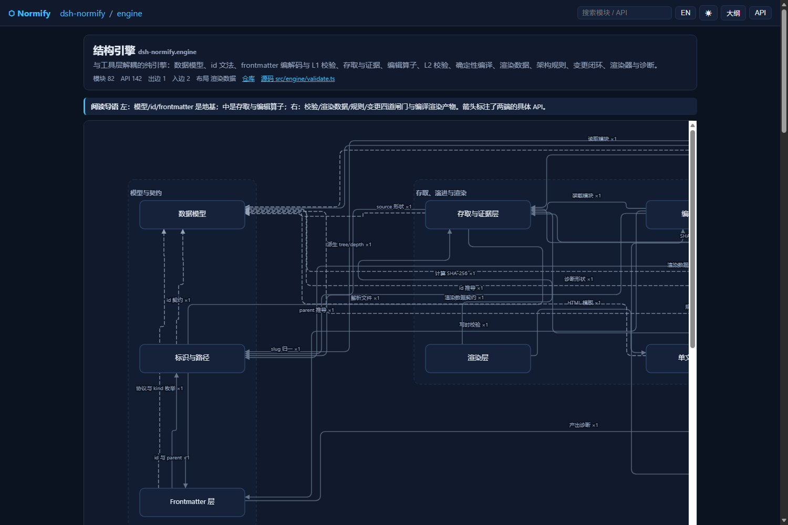
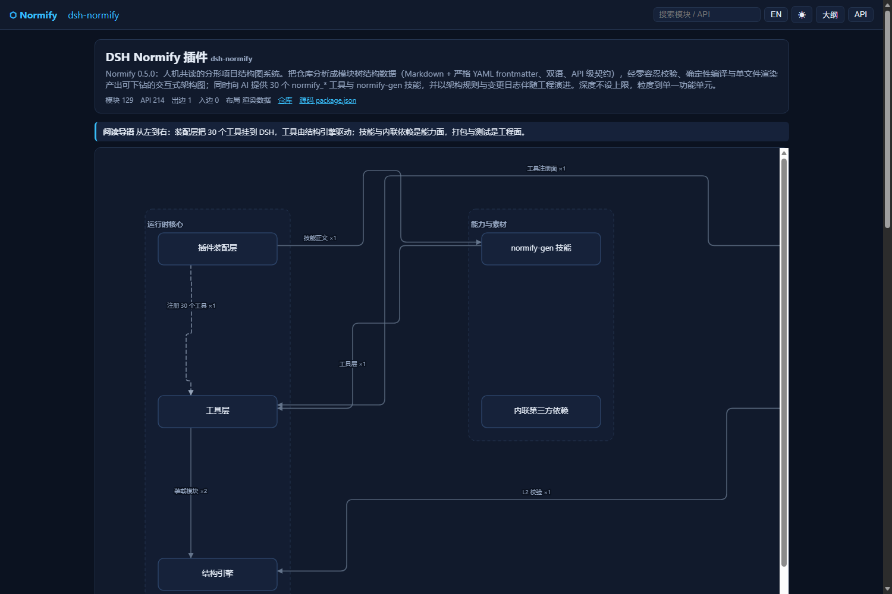
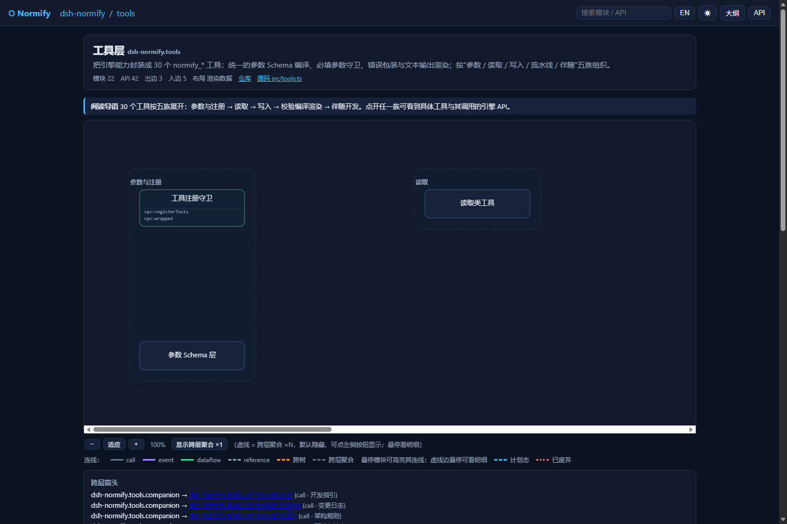
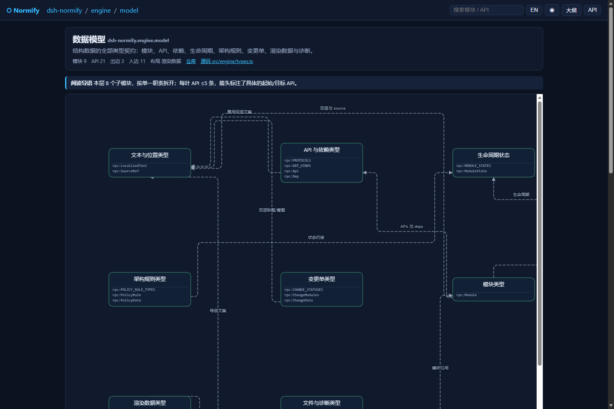

<p align="center">
  <strong>English</strong> · <a href="./README.md">简体中文</a>
</p>

<p align="center">
  
  
  
  
  
  
</p>

<h1 align="center">Normify · Normalized Architecture Map Builder</h1>

<p align="center"><b>Describe an entire project as a fractal module tree that both humans and AI can read: the AI analyses and authors, a deterministic engine validates, compiles and renders — open any module and you get a finer sub-graph.</b></p>

---

## 0. TL;DR

Normify is a **DeepSeek Harness (DSH) plugin** and, at the same time, **a development workflow written for AI agents**:

- **For the AI**: a `normify-gen` skill plus **7 primitive tools** (`normify_project` / `read` / `write` / `check` /
  `build` / `render` / `change`, dispatched by `op`; the 31 legacy tool names remain available via `legacyTools` for
  the transition) — the model turns a repository into a module-tree structure database and keeps it alive through
  development (design-first planned trees → implement → close the change).
- **For the engine**: zero-tolerance validation (L1 write-time / L2 project-wide / L3 frozen artifacts),
  deterministic compilation (five artifacts with a self-verifiable `receipt.sha256` chain) and
  render datasets (`renders/`) that decide *how each level is drawn*.
- **For humans**: a **single-file interactive architecture map** (`normify.html`) — drill-down levels, hover
  descriptions, one-click zh/en switch, deep links, multi-tree, **API-anchored arrows**, cross-level aggregation,
  zoom and search. Zero external dependencies: open it by double-clicking.

> It is not a "render a picture and you're done" tool: the structure data and the code are **contracts for each other**.
> `normify_check{op:"drift"}` detects drift after every change, and `normify_change{op:"close"}` (zero-error enforced)
> closes the loop, so the map never drifts away from the code.

<p align="center">
  
  <br><sub><b>Engine level</b>: 14 modules, API-anchored arrows (each arrow lands on a concrete API row), labelled subsystem dependencies, dashed cross-level aggregation</sub>
</p>

## 1. What problem does it solve?

| Pain | How Normify answers it |
| --- | --- |
| Diagrams rot the moment they are drawn | The structure data is **validatable source data**: `normify_check{op:"drift"}` reports fingerprint drift, `normify_change{op:"close"}` enforces zero errors |
| Diagrams are too coarse to show contracts | Granularity goes down to a **single functional unit**; APIs live on leaves and arrows can anchor to a concrete API (`from_api` / `to_api`) |
| AI cannot see the whole picture while editing | `normify_read{op:"brief"}` returns target contracts, impact surface (who depends on me), policy constraints and an acceptance checklist |
| Design-after-code always drifts | **Planned-first**: create the tree in `state: planned`, then `normify_change{op:"close"}` refreshes fingerprints and activates planned modules (legacy: `normify_module_refresh(activate)`) |
| Conventions rely on discipline | `policy.yml` rules (dependency direction / forbid / acyclic / depth / cross-tree / naming) are enforced by `validate` |
| Full regeneration is too heavy for big repos | Incremental regeneration: only the affected subtree is rebuilt, `layouts_to_review` names the levels to re-check |

## 2. Features

### 2.1 Data model — fractal and redundancy-free

- **One element**: the whole database is made of identical **modules** (each module = one Markdown file).
- **Only `parent` is stored**: one-way reference; `children` is derived, so parent and children can never disagree.
- **APIs only on leaves**, stored once: aggregation, statistics and indexes are compile-time derivations.
- **Two kinds of edges**: containment (tree edges, navigation skeleton) + dependency (arrows, cross-subtree and cross-tree, coloured by `kind`).
- **Path-style ids + immutable uid**: the AI navigates level by level like a binary search; `uid` survives renames and moves,
  so diffs stay stable.
- **Unlimited depth** (since 0.5.0): split as fine as you need; depth is no longer a reason to merge modules.

### 2.2 Three validation layers, fail-closed

| Layer | When | What |
| --- | --- | --- |
| **L1** | every write | required fields, id grammar, uid, parent consistency, bilingual lengths, source/apis/deps shapes, state/replacement |
| **L2** | `normify_check{op:"validate"}` | uniqueness, file↔id mapping, leaf/non-leaf rules, globally unique API keys, dependency targets, cycles, render-data cross checks, policy, change log, optional repository evidence (source existence + fingerprint match) |
| **L3** | `normify_build{op:"build"}` | nothing is emitted when any error exists; five artifacts (tree/outline/api-index/structure-manifest/receipt) plus a `receipt.sha256` receipt chain |

Every diagnostic carries `severity / code / message / subject / evidence / supportedFixes` so the **AI can fix it itself**.

### 2.3 Renderer — single file, drill-down, API-direct

- One HTML file (inline CSS/JS, **no external deps**, no telemetry); easy to archive or send to a colleague.
- Drill-down levels + breadcrumbs + search (module/API) + outline view + API browser.
- **API-direct arrows**: leaf boxes show API detail rows and arrows anchor to a concrete API row;
  multiple edges sharing one API row are fanned apart automatically.
- Cross-level dependencies aggregate into dashed `×N` edges (hidden by default; toggle with the toolbar or `?agg=1`).
- Deep links: `#module=<id>`, `#api=<rpc:key>`, `#view=outline`, `?lang=zh|en`, `?agg=1`; zoom, hover highlight, light/dark theme.
- **Geometry self-check**: the renderer is built around per-level geometry assertions (lines stay inside the viewBox,
  do not hug, cross or overlap boxes); the early standalone checker script is not shipped in this repository.

### 2.4 Companion development — design first

```
normify_change{op:"open"} → normify_read{op:"brief"} → normify_check{op:"check"}
  → normify_write{op:"batch"}(state=planned) → 【write the code】 → normify_change{op:"close"} (zero-error enforced)
  → verified + revision.after
```

- **Planned state**: a module may exist before its source does (`fingerprint: pending`); `normify_check{op:"validate"}` allows it.
- **No fake activation**: activating or closing before the source lands is refused.
- **Closing is a loop, not a flag**: refresh fingerprints → validate (zero-error) → build (optionally render) → mark
  `verified`; any failing step leaves the change untouched.
- **The map follows the code**: `normify_check{op:"drift"}` uses `git diff` plus untracked files to find affected modules and drift;
  `normify_write{op:"patch"}` updates them.

### 2.5 Policy first (`policy.yml`)

| Rule | Purpose |
| --- | --- |
| `dependency-direction` | layer order defines the allowed dependency direction (e.g. plugin → tools → engine) |
| `forbid-dependency` | forbid given from → to dependencies (filterable by kind / state) |
| `acyclic` | the dependency graph must be acyclic (optionally including cross-tree edges) |
| `max-depth` | id segment limit — **optional**; omit it and depth is unlimited (default since 0.5.0) |
| `cross-tree` | cross-tree strategy: `forbid` / `allow` / `require-to-api` |
| `naming` | regex over id segments inside a scope |

Once installed, `normify_check` (op=validate/check/drift) and `normify_build` (op=build) enforce it: **fix the design, don't bypass the rule**.

## 3. Release highlights

### v0.7.0 — default tool surface switched to 7 primitives (current)

- **7 primitives by default**: `normify_project / read / write / check / build / render / change` (dispatched by `op`,
  see §7); resident schema size and tool-selection ambiguity drop significantly.
- **Smooth transition**: `config.legacyTools: true` additionally registers the 31 legacy names (one minor);
  `config.toolset: "full"` restores the old 31-tool surface completely.
- **Unchanged**: structure-data format v1, five artifacts + SBOM + `verify` receipt chain, CLI commands/exit codes,
  installation and DSH compatibility range.
- **Evaluation**: new retrieval-layer evaluation (n≥3, reproducible — see [docs/EVAL-RESULTS.md](docs/EVAL-RESULTS.md));
  old A/B wording changed to "n=1 feasibility experiment" (methodology in [docs/EVAL.md](docs/EVAL.md)).
- **Distribution & decision gates**: new [docs/MARKET.md](docs/MARKET.md) (official market / dshbase / dshhub materials);
  ADR-0011 (no in-Harness UI panel for 0.7), ADR-0012 (no MCP adapter for 0.7; CLI-first).
- Verification: `pack-smoke --all --strict` **PASS 43 / FAIL 0 / WARN 0**; platform-contract 25/25 (7-primitive / legacy / full modes).

### v0.6.0 — Phase 1 internal refactor (core/dsh/cli + CLI + SBOM)

- `src/core` (pure-Node engine) / `src/dsh` (DSH adapter) / `src/cli` (cross-agent CLI); `lib/` no longer committed.
- Added CLI, structure SBOM (`structure-manifest.json`), self-verifiable `receipt.sha256` chain, `normify verify`,
  semantic structure diff.
- DSH adapter: real `output.schema` / presenters / destroy approval; test & CI matrix; much faster write path.
- **Public surface unchanged**: 31 legacy tool names, data format v1, installation contract (7 primitives are opt-in).

### v0.5.5 — P0 stop-the-bleeding: support the current DSH 0.2.x

- **Current DSH only**: `engines.dsh` is now `>=0.2.1-rc.1 <0.3.0` (target runtime: DSH `0.2.1-rc.5`).
  Only the current DSH line is supported; stay on 0.5.4 if you still run 0.1.x.
- **Security fixes**: `normify_sync` rejects `-`-prefixed git diff ranges (option injection); `normify_render`
  accepts a plain file name for `out` only (out-of-root names fail with `render/invalid-out`); and
  `normify_fingerprint` accepts repo-relative POSIX source paths only — out-of-root paths and symlinks are treated
  as missing rather than read.
- **Self-verifiable L3 receipts**: `receipt.json` no longer lists itself in `artifacts`; a sibling `receipt.sha256`
  sidecar covers it, so all five artifacts can be recomputed independently.
- **Data correctness**: reserved `index` last segment rejected before writing (`structure/id-reserved`), explicit
  errors for empty batches / orphan upserts / unreadable files (`args/empty-batch` / `structure/parent-not-exist`),
  cycle detection back in L2 (`structure/dependency-cycle`), and `delete`-only changes no longer deadlock
  `change_close`.
- **Renderer safety**: HTML `<title>` escaping and the `/s+/g` fix; atomic writes for artifact output.
- **Docs**: installation rewritten for the DSH 0.2.x plugin manager / plugin market; compatibility table, tool count
  (31), source size (17 `.ts` files / ~7.6k lines) and test suites (5) aligned.

### v0.5.4 — the four tool-side defects found by the second A/B run

Round 2 switched the project (a **spreadsheet formula engine + CLI**; same spec discipline, 88 hidden black-box
checks plus **differential fuzzing**). Final scores: B 88/88, A 87/88 (the single gap being one §5.2 ordering rule).
This release fixes the four *tool-side* issues that run exposed:

- **`mode:"patch"` silent no-op is now rejected**: `items:[{patch:{id, tags:[...]}}]` (one nesting level short) used to
  return `ok:true, count:1` while changing **nothing** — the worst kind of false success. It now fails with
  `args/invalid-patch`, echoing the received keys and the correct shape `{patch:{id, patch:{...}}}`. A single-module
  `normify_module_patch` with an empty patch now fails with `args/empty-patch` too (passing only `expect_updated_at`
  no longer slips through).
- **`normify_module_refresh` no longer hard-requires git**: with a non-git `repoRoot` it used to fail
  (the agent had to `git init` just to activate modules); it now degrades with a `refresh/git-unavailable` warning.
- **Clearer `change_open` acceptance errors**: putting a `{zh,en}` object into `acceptance` used to produce one vague
  error; it now says which entry is wrong ("entry #N is not a non-empty string … acceptance only accepts plain
  strings") and suggests putting localized text in `title`/`intent`.
- **`normify_help` gained `topic:"tool:<name>"`**: the `tools` topic now lists required/optional params per tool, and
  the new topic prints a full parameter tree (type / description / required), generated live from the registry and
  therefore in sync with runtime validation.

### v0.5.3 — the four friction points found by a real companion-development A/B

These come from an actual A/B run: two AIs implemented the same backend spec, one with the plugin driving the
companion flow, one writing plain code. Both scored **42/42** on a hidden black-box suite. The plugin side shipped an
extra 41-module / 110-API / 10-layer architecture dataset — and hit the four rough edges below:

- **`normify_help` now takes a `topic`**: it used to ignore its arguments entirely and always return the same field
  cheat-sheet, so the agent read the plugin source just to get exact parameter names (~4 minutes lost). Topics:
  `fields` (default) / `deps` (arrows + API-direct) / `renders` / `flow` / `tools` / `policy` / `errors` / `all`.
  An unknown topic now **fails loudly** and lists the valid ones instead of being silently ignored.
- **Project bootstrap**: new 31st tool `normify_project_init` creates `normify-<slug>/` plus the default policy,
  optionally with a planned root module in one call (idempotent). `normify_change_open` now also **creates the project
  directory on demand** (it used to fail with a "project directory missing" error), and `normify_brief` on a missing module returns an
  actionable hint instead of a bare error.
- **Causal batch diagnostics**: one `label-too-long` used to cascade into three `dep/target-missing` errors (L1-failed
  modules are removed from the batch working set). Follow-on errors are now reported as `dep/target-dropped` /
  `structure/parent-dropped` naming the **root-cause diagnostic**, and the failed response carries `root_causes` + a `hint`.
- **API-direct guidance**: arrows whose endpoints both declare APIs but that have no `from_api` / `to_api` now produce an
  aggregated `dep/unanchored` warning (count + first three examples). This was the wasted capability in the experiment:
  110 declared APIs, 54 arrows, zero anchored — unanchored arrows can only land on the box edge, never on an API row.
  Guidance, not relaxation: a wrong anchor key is still an error.

### v0.5.2 — three real data-corrupting defects fixed

- **`normify_module_upsert` keeps its required list**: `parameters.required` is `["frontmatter"]` again, and the 9
  mandatory frontmatter fields (uid / id / parent / name / description / source / revision / updated_at / fingerprint)
  are back in the schema. A nested schema was compiled twice, which silently dropped the whole required list, so the
  contract the model saw no longer matched what the runtime enforced.
- **`normify_module_move` rewrites migrated render data**: `id` / `order` / `groups.children` / `edge_hints` are all
  remapped to the new ids, plus the **old parent** (drops references to moved-out children) and the **new parent**
  (appends the new id to `order`) are maintained. Before the fix a move left the project failing L2 with
  `layout/id-mismatch` + `layout/order-child` (8–9 errors measured; 0 after 0.5.2).
- **Promotion hands APIs off**: when a leaf becomes a container (explicit `normify_module_promote`, auto-promotion when
  writing a child, or moving a subtree under a leaf) the stale `apis` are stripped from the container and reported as a
  `structure/api-dropped-on-promote` warning listing the dropped keys — previously the project hard-failed with `api/non-leaf`.
- **All API rows by default**: layout field `max_api_rows` defaults to **0 = expand all**; pass 1..48 to truncate.
- Each defect is locked in by `tests/regression-0.5.2.mjs` (34 assertions, all green).

### v0.5.1 — renderer: no more overlapping lines (12 → 0)

- **Fixed collinear line overlap**: from **12 overlaps across 28 levels → 0**. Four root causes:
  1. the primary router accepted the first candidate that merely did not cross *other* boxes — it never checked
     whether it lay on top of an already-drawn line → now only candidates with `violations === 0` are accepted;
  2. API-anchored ports were not fanned (several edges share one API row) → ±5.5px in-row fan-out;
  3. API ports on top/bottom sides were placed inside the box → they now fall back to even distribution along the edge;
  4. `segClear` skipped the source/target boxes entirely → new "enters its own box" check (inset 2px).
- Node/group spacing 170 → 220 so dense levels have more free channels.

### v0.5.0 — no module-count ceiling

- **Removed the hard `MAX_DEPTH = 12` limit**: drill down to single functional units; if a project really wants a depth
  limit, declare it in `policy.yml` (`maxDepth` widened to 1..64, scoped).
- Skill guidance: unlimited depth, batch limit 40 → 200, "keep 3–5 APIs per leaf".
<details>
<summary>Earlier versions (v0.4.x / v0.3 / v0.2 / v0.1)</summary>

- **v0.4.1**: renderer v3 (free-channel routing, dynamic viewBox, API-direct arrows, cross-level aggregation, zoom/hover);
  `normify_sync` now sees **untracked new files** (`git ls-files --others`).
- **v0.4.0**: companion development (`planned`/`deprecated`, `replacement`, `tags`), `policy.yml`, change log with
  `normify_change_close` (zero-error enforced), editing operators (`module_patch/batch/move/refresh`),
  `normify_brief` / `normify_check`, sync v2, reminder hook; tools 15 → 30.
- **v0.3.0**: render datasets (`order`/`groups`/`mode`/`reading`/`edge_hints`), id depth 8 → 12, finer granularity.
- **v0.2.0**: DSH 0.1.5-rc.2 adaptation; tool names `normify.x.y` → `normify_x_y`; bundle layer `cordis.patch.yml`;
  parameters compiled to standard JSON Schema; read-only tools marked `isConcurrencySafe`.
- **v0.1.0**: initial release (14 tools, data model v1, renderer v1).

</details>

## 4. Screenshots

| Overview (129 modules) | Tools (0.6 view: 31 tools; 7 primitives by default since 0.7) |
| --- | --- |
|  |  |

| Engine level (API-direct arrows) | Model level (clean routing after the 0.5.1 fix) |
| --- | --- |
|  |  |

> All four are **Normify mapping its own source** (129 modules / 214 APIs / 257 arrows / 28 render levels, `validate` 0 error).

## 5. Installation

Normify ships as a **DSH bundle** and supports **DSH 0.2.x only** (`engines.dsh: ">=0.2.1-rc.1 <0.3.0"`).
Open a **new DSH session** after installing: the tool list is snapshotted when a session starts.

### Option A — plugin manager / plugin market (recommended)

In a DSH session, ask the agent to install it through the plugin manager (`plugin_manager` → `install_bundle`).
The target can be:

- **this repository directory** (run `npm install && npm run build` first when installing from source;
  `lib/` is no longer committed to git, so it must be built);
- **the packed tarball** (`dsh-external-dsh-normify-<version>.tgz` produced by `npm pack`, or the matching
  Release asset) — the exact install spec is the one suggested by the plugin manager;
- **a plugin-market entry**, if the market index you configured already lists this plugin.

The DSH plugin manager validates `engines`, writes the profile and registers the bundle.
**You never edit the profile's `package.json`, `node_modules` or `cordis.patch.yml` by hand** — the plugin row is
declared by the bundle itself (`package.json > dsh.bundle.patch: ./cordis.patch.yml`).

### Option B — `dsh plugin` CLI

```bash
# <profile> is the current DSH profile name (see ~/.dsh/profiles/)
dsh plugin --profile <profile> add <absolute path to the dsh-normify directory or .tgz>
```

CLI arguments follow the `dsh plugin --help` shipped with your current DSH build; syntax may differ slightly
between builds.

### Verify

```text
In a new DSH session, ask the agent: list the normify tools you have
# default: 7 primitives; legacyTools:true adds the 31 legacy names; toolset:"full" gives the 31 legacy tools only
```

> ⚠️ On a version mismatch the plugin manager reports `incompatible-version` and rolls back: use **0.7.0+**
> (supports DSH 0.2.x); if you still need DSH 0.1.x, stay on 0.5.4.

## 6. Quick start

Once installed, just talk to the AI. The three most common prompts:

```text
# 1) map a repository
Use the normify-gen skill to build a structure tree and render an architecture map for F:\my-project,
with granularity down to single functional units.

# 2) design first, then code
I want to add a "rate limiting" module to my-project: give me a brief first (normify_read op=brief),
create it in planned state, then I implement it and you change_close (it refreshes and activates planned modules).

# 3) sync after code changes
Sync the structure map of my-project (normify_check op=drift): update affected modules and render data,
then build + render once validate reports 0 errors.
```

Under the hood the agent runs (7 primitives by default since 0.7; ops in parentheses):

```text
normify_project{op:"init"} → normify_write{op:"batch"} (root + first level, atomic)
  → normify_read{op:"list"} (drill down)
  → normify_write{op:"layout_upsert"} (one render dataset per container)
  → normify_check{op:"validate"} (zero-error gate)
  → normify_build{op:"build"} → normify_render{op:"render"}
  → normify_build{op:"verify"} (or CLI `verify`) confirms the receipt chain
```

Artifacts (inside the structure directory `normify-<slug>/`):

| Artifact | Content |
| --- | --- |
| `modules/**/*.md` | the structure data itself (frontmatter + body) |
| `renders/**/*.json` | one render dataset per container level |
| `policy.yml` | architecture rules (defaults installed at project creation) |
| `changes/<id>.json` | development change log, archived together with the structure |
| `tree.json` | compiled: module dictionary + API index + edges + layouts + policy + change stats |
| `outline.md` / `api-index.json` | human-readable outline / API index |
| `structure-manifest.json` | structure SBOM: deterministic module/API/dependency inventory + artifact hashes (since 0.6.0) |
| `receipt.json` | SHA-256 frozen receipt of all artifacts (does not include itself) |
| `receipt.sha256` | checksum of `receipt.json` itself (sidecar, for external recomputation) |
| `normify.html` | the single-file interactive map |

## 7. Tool surface: 7 primitives (legacyTools transition)

Since 0.7.0 DSH registers **7 primitives by default** (dispatched by `op`). The CLI still uses the full tool set internally
(commands unchanged).

| Primitive | ops | Purpose |
| --- | --- | --- |
| `normify_project` | `init` / `list` / `status` | initialise a project (optional planned root) / list projects / project overview |
| `normify_read` | `get` / `list` / `search` / `deps` / `outline` / `brief` / `layout` / `policy` | read-only queries: module / list / search / reverse deps / outline / brief / layout / policy |
| `normify_write` | `upsert` / `patch` / `batch` / `move` / `delete` / `promote` / `layout_upsert` / `layout_delete` | transactional writes (L1 validation, atomic batch, `dry_run`) |
| `normify_check` | `validate` / `check` / `drift` / `policy` | L2 validation / design pre-flight / git drift & incremental plan / read policy |
| `normify_build` | `build` / `verify` / `sbom` | compile five artifacts + SBOM + receipt chain / verify-only / SBOM only |
| `normify_render` | `render` | render the single-file interactive HTML (`out` accepts a plain file name only) |
| `normify_change` | `open` / `update` / `list` / `close` | change lifecycle; `close` enforces zero errors and activates planned modules |

**Tool-surface config** (plugin config):

| Config | Default | Effect |
| --- | --- | --- |
| `toolset: "core"` | ✅ | register the 7 primitives only |
| `toolset: "full"` | — | register the 31 legacy tools only (the 0.6 surface) |
| `legacyTools: true` | `false` | additionally register the 31 legacy names (one minor, removed in 0.8) |

- `legacyTools:true` registers 7 + 28 = 35 entries; `normify_check` / `normify_build` / `normify_render` are also legacy names,
  so use the primitive `op` during the transition.
- The CLI (`normify ...` / `call <tool>`) is not affected by the plugin `toolset` and can always use all 31 legacy tools.

**31 legacy names → primitive op (migration map)**

| Legacy tool (0.6) | 0.7 usage |
| --- | --- |
| `normify_project_init` / `normify_tree_list` | `normify_project{op:"init" / "list"}` |
| `normify_module_get` / `_list` / `_search` / `_deps_find` / `_outline` / `_brief` | `normify_read{op:"get"/"list"/"search"/"deps"/"outline"/"brief"}` |
| `normify_layout_get` / `normify_policy_get` | `normify_read{op:"layout"/"policy"}` |
| `normify_module_upsert` / `_patch` / `_batch` / `_move` / `_delete` / `_promote` | `normify_write{op:"upsert"/"patch"/"batch"/"move"/"delete"/"promote"}` |
| `normify_layout_upsert` / `normify_layout_delete` | `normify_write{op:"layout_upsert"/"layout_delete"}` |
| `normify_validate` / `normify_sync` | `normify_check{op:"validate"/"drift"}` |
| `normify_build` / `normify_render` | `normify_build{op:"build"/"verify"/"sbom"}` / `normify_render{op:"render"}` |
| `normify_change_open` / `_update` / `_list` / `_close` | `normify_change{op:"open"/"update"/"list"/"close"}` |
| `normify_fingerprint` / `normify_module_refresh` / `normify_help` / `normify_policy_upsert` | **no primitive equivalent**: enable `legacyTools:true` or use the CLI (`normify call ...`) |

> Parameter trees: `normify_help{topic:"tool:<name>"}` (legacy mode) or
> `node lib/cli/index.js call <tool> --args-json ...`.

## 8. Module frontmatter

```yaml
---
uid: 8c69b5a8                 # 8 lowercase hex, unique per project, never changes
id: dsh-normify.engine.ids    # dotted path id; first segment = tree name; unlimited depth
parent: dsh-normify.engine    # must equal the id minus its last segment; null for a root
name: {zh: "标识与路径", en: "Identifiers & Paths"}
description:                  # bilingual, ≤500 chars each, read by humans and AI alike
  zh: >
      模块 id 的文法、派生与 id ↔ 文件路径的双向映射。
  en: >
      Module id grammar, derivations and the id ↔ file-path mapping.
source:                       # code evidence (repo-relative path + optional line range)
  - {path: src/engine/ids.ts, line: 6, end_line: 34}
revision: 90df4a10…           # 40-hex git SHA at generation time
updated_at: "2026-09-12T12:00:00Z"
fingerprint: 630ac9020dba…    # deterministic fingerprint of source (use normify_fingerprint)
state: active                 # active | planned | deprecated
tags: [engine, ids]           # optional, ≤12
apis:                         # leaves only; 3–5 per leaf recommended
  - protocol: rpc             # http|ws|rpc|amqp|kafka|mysql|redis|file|grpc|graphql
    path: splitId
    description: {zh: "解析 id 为段数组。", en: "Parses an id into segments."}
deps:                         # outgoing arrows (stored on the source side only)
  - kind: call                # call|event|dataflow|reference
    to: dsh-normify.engine.model.module
    from_api: rpc:splitId     # optional: anchor to one of this module's APIs (API-direct)
    to_api: rpc:Module
    label: {zh: "id 契约", en: "Id contract"}
---
(body: optional long-form introduction for humans)
```

File layout: `modules/<tree>/<segments…>/index.md` for containers, `<last>.md` for leaves — maintained by the tools.

## 9. Render datasets (`renders/`)

One per **container** module, mirroring the module tree:

```json
{
  "schema_version": 1,
  "id": "dsh-normify.engine.model",
  "updated_at": "2026-09-12T12:00:00Z",
  "mode": "grid",              // auto | layers | groups | grid
  "max_columns": 3,            // 1..6
  "max_api_rows": 0,           // 0 = expand all (default); 1..48 = truncate
  "reading": {"zh": "本层 8 个子模块…", "en": "…"},
  "order": ["dsh-normify.engine.model.text", "…"],
  "groups": [{"id": "model", "title": {"zh": "模型与契约", "en": "Model"}, "children": ["…"]}],
  "edge_hints": [{"from": "a", "to": "b", "lane": 2, "style": "curve"}]
}
```

Readability recipes: **order = data flow**, **groups = domain boundaries**, **reading = the path**, long back-edges
get explicit lanes via `edge_hints`.

## 10. Companion development

### 10.1 Design first

```text
(1) normify_change{op:"open"}       open a change (title / intent / modules / acceptance)
(2) normify_read{op:"brief"}        contracts, impact surface, policy constraints, suggested modules, checklist
(3) normify_check{op:"check"}       pre-flight the proposed modules and dependencies
(4) normify_write{op:"batch"}       create planned modules (state=planned, fingerprint=pending)
                                    plus normify_write{op:"layout_upsert"} for that level in the same round
(5) 【write the code】
(6) normify_change{op:"close"}      refreshes fingerprints and activates planned modules
(7) zero-error close: refresh → validate → build → verified + revision.after
```

Planned modules keep `normify_check{op:"validate"}` at 0 errors (a missing source is only a warning), and activating or
closing before the code lands is refused.

### 10.2 Companion update

```text
(1) change the code (committed or not)
(2) normify_check{op:"drift"}       changed_files / affected / drift_fingerprints / layouts_to_review
                                    and "suggested modules" for new files (with ids and target paths)
(3) normify_write{op:"patch"}       add APIs, refresh descriptions, tags, etc.
(4) normify_check{op:"validate"}    0 errors
(5) normify_change{op:"close"}      close and rebuild artifacts (tree.json reflects the change stats)
```

## 11. Repository layout & engineering

```bash
npm install          # devDependencies (typescript / @types/node / cordis / schemastery / cosmokit)
npm run build        # src/ → lib/ via tsc (lib/ is not committed; build before use)
npm run typecheck    # tsc --noEmit
npm test             # 6 e2e/regression suites: engine / companion / regression-0.5.2 / 0.5.3 / 0.5.4 / 0.5.5
npm run test:unit    # core-unit (engine unit tests)
npm run test:contract # platform-contract (7-primitive / legacy / full modes) + pack-smoke --contract
npm run test:perf    # performance smoke (300 modules, generous threshold)
node ci-contract-check.cjs           # bundle declaration + full 31 tools + provider-safe names
node scripts/check-core-boundary.mjs # core must not import @deepseek-ai; cli must not import ../dsh
node scripts/gen-diagnostics.mjs     # regenerate docs/DIAGNOSTICS.md from source
node scripts/pack-smoke.mjs --all --strict   # release-package smoke (requires local DSH desktop app)
```

| Path | Content |
| --- | --- |
| `src/core/` | pure-Node engine (DSH-independent): `engine/*` + `toolset.ts` (31 legacy specs) + `primitives.ts` (7 primitive specs) |
| `src/dsh/` | DSH adapter: real `ToolDefinition`s (output schema + presenters + approval); decides 7-primitive / legacy / full surface |
| `src/cli/` | CLI (built to `lib/cli/index.js`, `bin: normify`); depends on core only |
| `lib/` | compiled output (`tsc`; **not in git**, shipped in the npm package) |
| `skills/normify-gen/` | thin skill `SKILL.md` (≤150 lines) + `references/` (format/validation/recipes/migration/examples/toolset) |
| `tests/` | 6 e2e/regression suites + core-unit + platform-contract + performance smoke |
| `docs/` | `SPEC.zh-CN.md` (single source of truth) + COMPATIBILITY / MIGRATION / RELEASE-CHECKLIST / DIAGNOSTICS / MARKET / EVAL / adr |
| `vendor/` | vendored schemastery + cosmokit (loaded by relative path) |

## 12. Compatibility & troubleshooting

| Item | Requirement |
| --- | --- |
| DSH | `0.2.1-rc.5` (engines `>=0.2.1-rc.1 <0.3.0`; peer: `@deepseek-ai/cordis ^4`) |
| Support policy | **only the current DSH line (0.2.x)**; stay on 0.5.4 if you still run 0.1.x |
| Tool surface | 7 primitives by default; `legacyTools:true` adds 31 legacy names; `toolset:"full"` = 31 legacy tools |
| Node.js | ≥ 18 |

> Full compatibility matrix and evidence: [docs/COMPATIBILITY.md](docs/COMPATIBILITY.md); upgrade guide: [docs/MIGRATION.md](docs/MIGRATION.md).

- **Installed but no tools** → the tool list is snapshotted at session start: open a **new session** (or restart DSH).
- **Legacy tool name reports unknown tool** → 0.7 registers only the 7 primitives by default: set `legacyTools: true`
  (transition) or use the primitive op (map in §7).
- **Install fails with `incompatible-version`** → the plugin version is outside the DSH runtime's engines range:
  upgrade the plugin to 0.7.0+; on DSH 0.1.x stay on 0.5.4.
- **`evidence/fingerprint-drift`** → the code moved ahead of the structure data: run `normify_check{op:"drift"}`,
  then `change{op:"close"}` refreshes (legacy: `normify_module_refresh`).
- **`structure/leaf-too-coarse`** → not an error: that leaf can be split further (towards single functional units).

## 13. Security & privacy

- **No telemetry, no network calls**: structure data and artifacts are generated locally; `normify.html` loads nothing external.
- **No credential handling**: the plugin never reads or writes tokens, keys or passwords; `.gitignore` excludes
  `.env*`, `*.pem`, `*.credentials.yaml`. **There are no credentials in this repository — please keep it that way.**
- **Read-only on your code**: the generator never modifies the analysed repository; it only writes into `normify-<slug>/`.
- `source` records only repo-relative paths and line numbers, never source text.

## 14. CLI (cross-agent / CI)

The CLI uses the **same engine** as the DSH tools and does not depend on the DSH runtime: use it in terminals, CI and other agents.
`lib/` is not committed, so build first when running from source (`npm run build`); the npm package already ships `lib/`.

```bash
node lib/cli/index.js --help        # commands, options and exit codes
node lib/cli/index.js tools         # JSON: the full 31-tool set (the CLI is not affected by the plugin toolset)
node lib/cli/index.js verify --project demo   # recompute receipt.sha256 → receipt → artifacts

# Common: locate a project with --project <slug> or --dir <absolute structure dir>
node lib/cli/index.js init --project demo --root-id demo
node lib/cli/index.js validate --project demo --repo-root F:/repo
node lib/cli/index.js build --project demo    # tree/outline/api-index/structure-manifest/receipt
node lib/cli/index.js render --project demo --out normify.html
node lib/cli/index.js sync --project demo --repo-root F:/repo --diff HEAD~1
node lib/cli/index.js change-open --project demo --args-json '{"title":{"zh":"…","en":"…"},"acceptance":["…"]}'
node lib/cli/index.js call <tool-name> --args-json '<json>'   # invoke any tool directly
```

| Command | Purpose |
| --- | --- |
| `init` / `status` / `list` / `get` / `search` / `brief` | init / overview / list modules / get module / search / development brief |
| `validate` / `check` | project-wide L2 validation / design pre-flight |
| `build` / `verify` / `render` | compile the five artifacts / receipt-chain verification / single-file HTML |
| `sync` | incremental regeneration planner (read-only) |
| `change-open` / `change-list` / `change-close` | change log and zero-error close |
| `project-list` / `policy` / `help` / `tools` / `call` | list projects / read policy / help / tool list / direct tool call |

- After installation use `normify <command>` (the `bin` maps to `lib/cli/index.js`); otherwise `node lib/cli/index.js`.
- JSON output by default; `--quiet` prints one-line JSON. **Exit codes are a stable contract**:
  `0` success; `2` validation/L2 error (including a failed `verify`); `4` argument/usage error; `5` other failure; `6` security refusal.
- `build --verify-only` (CLI) / `normify_build{op:"verify"}` (primitive) only verifies the receipt chain, without recompiling.

## 15. Documentation

| Document | Content |
| --- | --- |
| [`docs/SPEC.zh-CN.md`](docs/SPEC.zh-CN.md) | formal specification v1.0 (data model / source format / artifacts / validation / generator / renderer, single source of truth) |
| [`docs/COMPATIBILITY.md`](docs/COMPATIBILITY.md) | DSH × plugin version × verification status (pack-smoke evidence) |
| [`docs/MIGRATION.md`](docs/MIGRATION.md) | 0.5.4→0.5.5, 0.5.x→0.6.0, 0.6.x→0.7.0 (default surface switch + legacyTools) |
| [`docs/RELEASE-CHECKLIST.md`](docs/RELEASE-CHECKLIST.md) | per-release checklist (build/test/smoke/checksum/tag) |
| [`docs/DIAGNOSTICS.md`](docs/DIAGNOSTICS.md) | diagnostic-code index (generated from source by `scripts/gen-diagnostics.mjs`) |
| [`docs/MARKET.md`](docs/MARKET.md) | marketplace materials (official market / dshbase / dshhub + user action checklist) |
| [`docs/EVAL.md`](docs/EVAL.md) / [`docs/EVAL-RESULTS.md`](docs/EVAL-RESULTS.md) | evaluation protocol (n≥3 / isolated profiles / blind review) and retrieval-layer results |
| [`docs/adr/0011-ui-panel-decision.md`](docs/adr/0011-ui-panel-decision.md) / [`0012-mcp-adapter-decision.md`](docs/adr/0012-mcp-adapter-decision.md) | decision gates: no UI panel / no MCP for 0.7 (CLI-first) |
| [`skills/normify-gen/SKILL.md`](skills/normify-gen/SKILL.md) | thin skill entry (details in `references/`: format/validation/recipes/migration/examples/toolset) |
| [`docs/RELEASE-0.7.0.md`](docs/RELEASE-0.7.0.md) | current release notes (7-primitive default surface) |
| [`CHANGELOG.md`](CHANGELOG.md) | version history (0.1.0 → 0.7.0) |
| [`CONTRIBUTING.md`](CONTRIBUTING.md) | contributing guide |
| [`SECURITY.md`](SECURITY.md) | security policy |

## License

[MIT](LICENSE) © yan-mc

---

<p align="center"><sub>Normify — let the architecture map grow together with the code.</sub></p>
